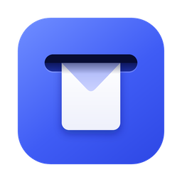
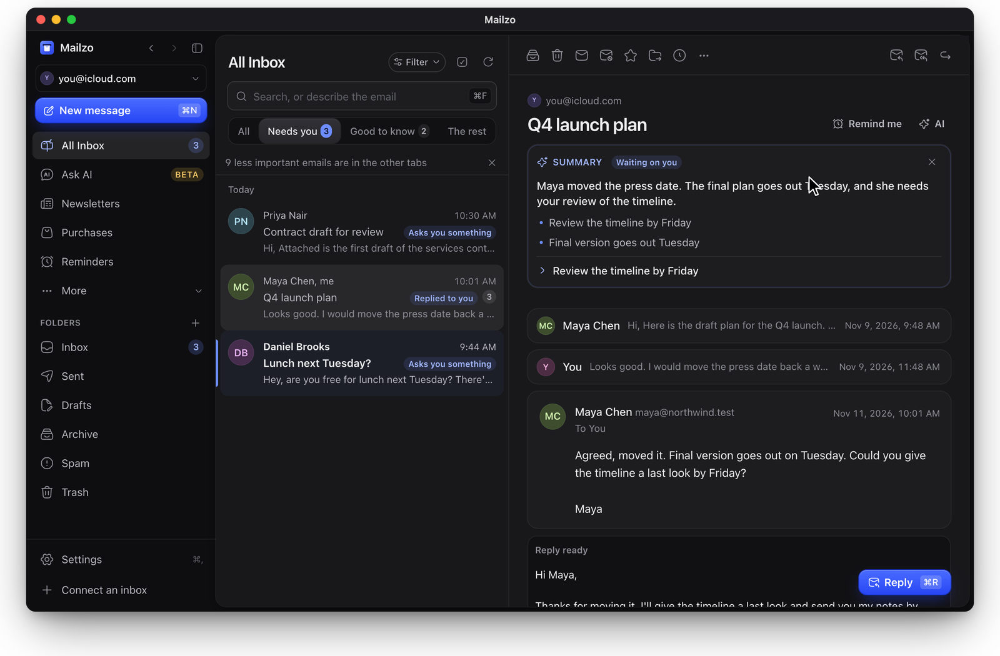
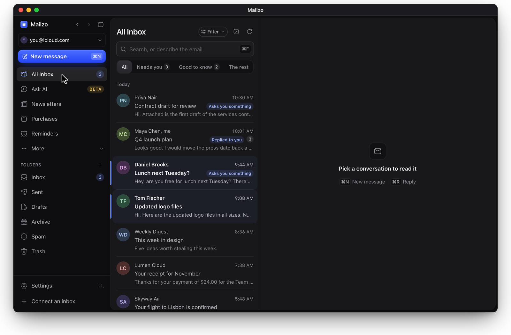
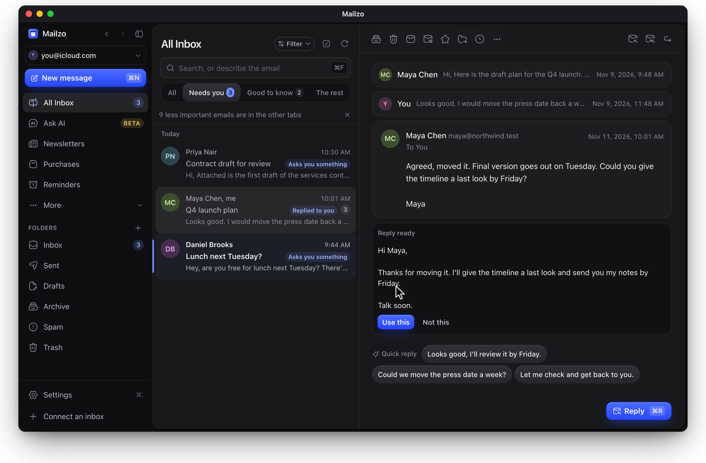
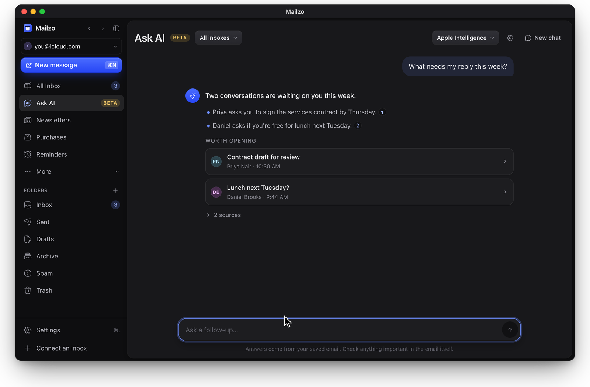
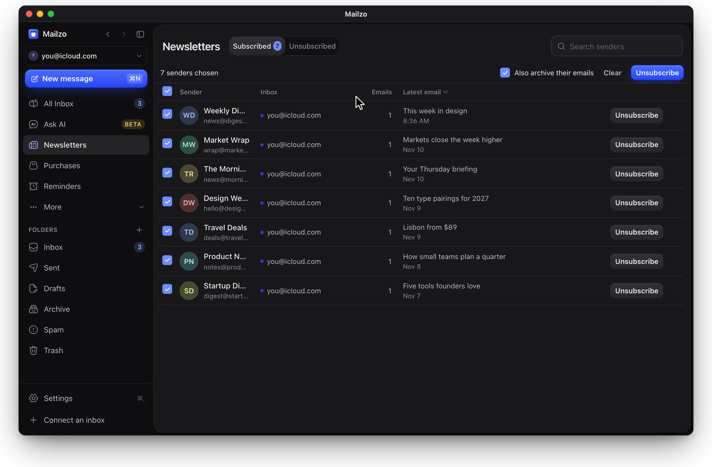
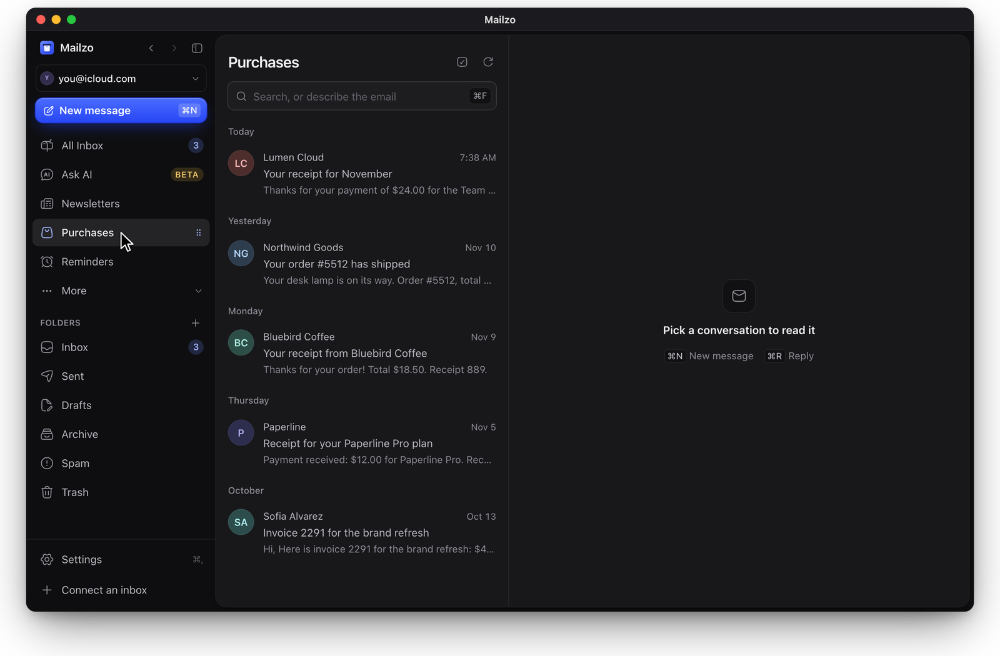
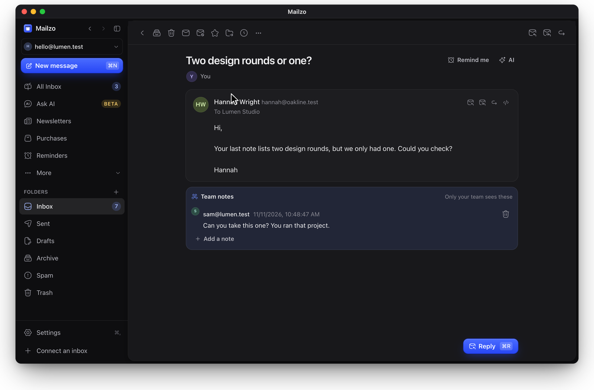

<div align="center">



# Mailzo

### The free, open-source email app for Mac that sorts your inbox and keeps your mail private

Gmail, Outlook, iCloud and any IMAP address in one calm inbox. What needs you comes first, AI writes your replies (with your own AI or Apple Intelligence), and your mail stays on your own Mac.

[**Download for Mac**](https://updates.getmailzo.com/Mailzo.dmg) · [Website](https://getmailzo.com) · [Help](https://getmailzo.com/help) · [Releases](../../releases)

[](../../releases/latest)
[](https://updates.getmailzo.com/Mailzo.dmg)
[](LICENSE)



</div>

## Why Mailzo

- **Free, every feature.** No trial, no paywall on the app, no ads. The code is open under AGPL-3.0.
- **Private by design.** Mail is stored encrypted on your Mac and goes straight to your own mail server, never through ours. No account needed.
- **A sorted inbox.** Mailzo puts the emails that need you first and moves newsletters, receipts and updates out of the way.
- **AI that works for you, on your terms.** Summaries, replies and inbox questions use Apple Intelligence on your Mac, a Claude or ChatGPT plan you already pay for, or your own API key. Nothing is sent to AI unless you turn it on.
- **Works with the email you have.** Gmail, Google Workspace, Outlook, Microsoft 365, iCloud, Yahoo, Fastmail and any IMAP account.

A good fit if you're looking for a private, free alternative to Spark, Superhuman, Outlook or Apple Mail.

## Features

### What needs you comes first

Mailzo reads each new email and sorts it into **Needs you**, **Good to know** and **The rest**. Questions, requests and replies to you stay on top, and you can see why each one is there ("Asks you something", "Replied to you").



### Replies written before you open the email

For an email that needs an answer, a reply is ready when you open it. Use it, change it, or pick a one-tap quick reply. The AI writes in your own style.



### Ask your inbox anything

Ask "What needs my reply this week?" or "Find my invoices from last month". Mailzo answers from your own email and links to each source.



### Newsletters and purchases, sorted for you

All your newsletters on one page, with one-click unsubscribe for many at once. Receipts, orders, bills and shipping updates collect in **Purchases**.

<table>
<tr>
<td width="50%"></td>
<td width="50%"></td>
</tr>
</table>

### Made for teams too

Share an inbox with your team, assign emails, and leave private notes that only your team can see.



### And the everyday tools

| | |
|---|---|
| **Privacy** | Blocks and names tracking pictures, strips tracking codes from links, Touch ID lock, encrypted email (OpenPGP) that works with Thunderbird, Proton and GPG |
| **Inbox tools** | Snooze, send later, undo send, follow-up reminders, templates, filters written as a plain sentence, new-sender screening |
| **Built in** | Contacts, calendar, unified inbox for all your accounts, fast search, keyboard shortcuts |
| **Connect AI apps** | Let Claude and other AI apps read or draft email through MCP, with a switch for each thing they may do |
| **Your language** | English, Deutsch, Español, Français, Português, 日本語, 한국어, 中文 |

## Install

1. [Download Mailzo.dmg](https://updates.getmailzo.com/Mailzo.dmg), or get it from [Releases](../../releases/latest).
2. Open it and drag Mailzo into Applications.
3. Open Mailzo and connect an inbox.

Mailzo is signed and checked by Apple, so it opens like any other app. It needs macOS 12 or later on a Mac with Apple silicon (M1 or later). After that, Mailzo updates itself.

## FAQ

**Is Mailzo really free?**
Yes. The Mac app and all its features are free and open source. Mailzo Cloud is an optional paid service that adds a web version, mail and scheduled sending that keep going with your Mac closed, AI included without a key, a daily brief and AI sorting.

**Does Mailzo read or store my email on its servers?**
No. Your mail is stored encrypted on your Mac and goes straight between your Mac and your own mail provider. The app talks to Mailzo's account server only if you sign in, and then only for sign-in codes, your device list and an encrypted vault for settings, which can't read your mail or passwords.

**Which email accounts work?**
Gmail, Google Workspace, Outlook, Hotmail, Microsoft 365, iCloud, Yahoo, Fastmail, Proton (through Proton Bridge) and any other address that supports IMAP.

**Do I need an AI subscription?**
No. AI is optional. Apple Intelligence works free on your Mac, and you can also use a Claude or ChatGPT plan you already have, or your own API key. Encrypted email never goes to AI.

**Is there a Windows, iPhone or web version?**
Mailzo is for the Mac today. A web version is part of Mailzo Cloud.

**How is Mailzo different from Spark, Superhuman or Apple Mail?**
Mailzo is free and open source, keeps your mail on your own Mac instead of its servers, and lets you choose your AI. See the [full comparison](https://getmailzo.com/#compare).

## Build from source

You need macOS, [Rust](https://rustup.rs), Node.js and [pnpm](https://pnpm.io).

```bash
cd app && pnpm install && cd ..
scripts/check.sh
scripts/dev-web.sh
```

`scripts/check.sh` runs every check. `scripts/dev-web.sh` runs the screens in a browser with a demo mailbox at http://127.0.0.1:5177. The demo's address and password are in `dev/fakeimap/src/lib.rs`, on server `127.0.0.1`, port `1143`.

| Task | Command |
|---|---|
| Build the Mac app for your own Mac | `scripts/build-mac.sh` |
| Build a `.dmg` to share | `scripts/build-dmg.sh` |
| Test the real Mac app | `scripts/mac-selftest.sh` (also needs a development account server; without one, run the engine tests and `scripts/dev-web.sh`) |
| Build for the iPhone simulator | `scripts/ios-sim.sh` |

How it's built:

- `core/` is the mail engine in Rust: accounts, sync and the local database.
- `app/ui/` is the screens (React). `app/src-tauri/` is the Mac app around them (Tauri).
- `dev/` has small fake mail and sign-in servers, so everything can be tested without real accounts.
- `docs/DESIGN.md` is the design system. Raw colours and sizes belong only in `app/ui/tokens.css`.
- Paid Mailzo Cloud features run on our servers and switch on after signing in to a paid account. Their server side isn't part of this repository.

To use your own account server, set `INBOX_ACCOUNT_SERVER` when building. Browser sign-in for Google and Microsoft needs your own client IDs in `INBOX_GOOGLE_CLIENT_ID`, `INBOX_GOOGLE_CLIENT_SECRET` and `INBOX_MICROSOFT_CLIENT_ID`. Copy `.env.example` to `.env`, which is never committed, and fill them in.

## Contributing and security

Contributions are welcome. Read [CONTRIBUTING.md](CONTRIBUTING.md) first. To report a security problem privately, see [SECURITY.md](SECURITY.md).

## Licence

[AGPL-3.0](LICENSE). Copyright (C) 2026 Grayic LLC. The Mailzo name and logo aren't covered by the licence.
